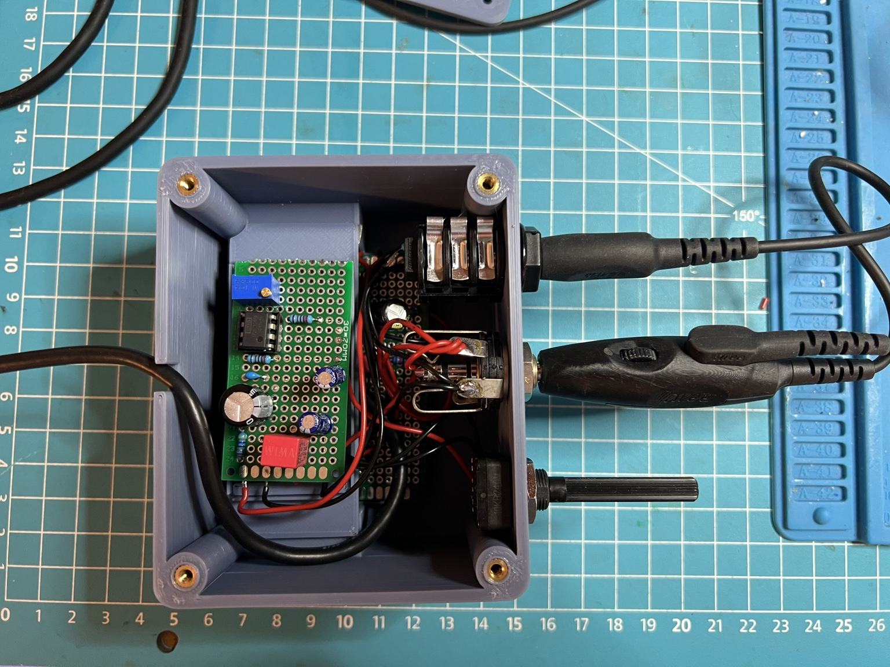

# GA Headset USB Adapter — Dual-GA Aviation Headset to USB for Flight Simulators

DIY-Adapter zum Anschluss eines Dual-GA-Aviation-Headsets, beispielsweise eines **Lightspeed Zulu 4**, an einen PC oder Flugsimulator über USB.

**Aktueller getesteter Entwicklungsstand: V2.0.0 mit regelbarem analogem Sidetone.**

> **Nur für PC-/Simulator-Nutzung. Kein zertifiziertes Luftfahrtgerät. Nicht im Flugzeug verwenden und nicht an Flugzeug-Audio-, Funk-, Intercom- oder Bordstromsysteme anschließen.**  
> Siehe [DISCLAIMER](DISCLAIMER.md).


<a href="https://buymeacoffee.com/soso1999">
  
</a>

## Versionen

| Version | Status | Funktionen |
|---|---|---|
| **V1.0.0** | stabiler getesteter Prototyp | Dual-GA auf USB, Mikrofon-Bias, Stereo-Kopfhörerausgang |
| **V2.0.0** | getesteter Prototyp | alles aus V1 plus regelbarer analoger Sidetone, OPA2134-Vorverstärker und überarbeitete Audio-Mischung |

V1 bleibt vollständig dokumentiert und wird nicht überschrieben. Die ursprünglichen V1-Dateien befinden sich weiterhin in `hardware/`, `docs/` und `cad/`.

Die V2-Erweiterung befindet sich separat unter [`v2/`](v2/README.md).

## V2 — Analog Sidetone

V2 ergänzt den funktionierenden V1-Adapter um einen **analogen Sidetone-Pfad**.

Das Mikrofonsignal wird am GA-Mikrofonanschluss abgegriffen, analog verstärkt, über einen eigenen Lautstärkeregler eingestellt und anschließend getrennt in den linken und rechten Kopfhörerkanal eingespeist.

Dadurch ist die eigene Stimme im Headset **praktisch ohne wahrnehmbare Software-Latenz** hörbar, ähnlich dem Sidetone-Erlebnis in einem Flugzeug-Intercom.

Beim getesteten **Lightspeed Zulu 4 Dual-GA** sind Sprachwiedergabe und PC-Audio sauber; im praktischen Betrieb des fertigen V2-Prototyps ist kein störendes Hintergrundgeräusch aufgefallen.

### Front

Von links nach rechts:

**Sidetone-Lautstärke — GA-Mikrofon — GA-Kopfhörer**


### Innenaufbau

Die V2-Sidetone-Schaltung ist als separate Zusatzplatine ausgeführt. Die funktionierende V1-Grundschaltung bleibt erhalten.




## Finale getestete Audio-Mischung V2

Die funktionierende Kombination des V2-Prototyps ist:

```text
USB-Soundkarte LEFT  ── 100 Ω ── J2 Tip   (links)
USB-Soundkarte RIGHT ── 100 Ω ── J2 Ring  (rechts)

SIDETONE OUT ────────── 220 Ω ── J2 Tip
SIDETONE OUT ────────── 220 Ω ── J2 Ring

GND ───────────────────────────── J2 Sleeve
```

Für links und rechts werden **zwei getrennte 220-Ω-Widerstände** verwendet.

**Tip und Ring dürfen nicht direkt durch einen einzelnen Widerstand miteinander verbunden werden**, da dadurch die beiden Stereo-Kanäle gekoppelt würden.

Der normale PC-/Simulator-Sound bleibt damit stereo, während das Mono-Sidetone-Signal auf beiden Ohren hörbar ist.

## V2-Dokumentation

| Inhalt | Datei |
|---|---|
| V2-Übersicht | [v2/README.md](v2/README.md) |
| V2-Stückliste | [BOM](v2/hardware/BOM.md), [CSV](v2/hardware/BOM.csv) |
| V2-Schaltplan / Funktionsschema | [Schematic](v2/hardware/schematic.md) |
| V2-Verdrahtung | [Wiring](v2/docs/wiring.md) |
| Aufbau und Inbetriebnahme | [Build](v2/docs/build.md) |
| Fehlersuche und bekannte Grenzen | [Troubleshooting](v2/docs/troubleshooting.md) |
| V2-Gehäuse / CAD / STL / Sidetone-Knauf | [CAD](v2/cad/README.md) |
| Release Notes | [v2.0.0](releases/v2.0.0.md) |

## V1-Dokumentation

Die ursprüngliche V1-Dokumentation bleibt erhalten:

| Inhalt | Datei |
|---|---|
| V1-Stückliste | [BOM](hardware/BOM.md), [CSV](hardware/BOM.csv) |
| V1-Schaltplan | [Schaltplan](hardware/schematic.md) |
| V1-Verdrahtung | [Verdrahtung](docs/wiring.md) |
| V1-Aufbau | [Bauanleitung](docs/build.md) |
| V1-Troubleshooting | [Troubleshooting](docs/troubleshooting.md) |
| V1-Gehäuse / CAD | [CAD](cad/README.md) |
| V1 Release Notes | [v1.0.0](releases/v1.0.0.md) |

## Hinweis zur Erprobung

V1 und V2 sind dokumentierte, funktionierende Einzelprototypen. Es wurden keine standardisierten EMV-, Rausch-, Frequenzgang-, Klirr- oder Langzeitmessungen durchgeführt.

Aus dem erfolgreichen Betrieb kann keine allgemeine Kompatibilität mit anderen GA-Headsets, USB-Soundkarten oder Hardwarekonfigurationen abgeleitet werden.

## Unterstützung

Wenn dir das Projekt beim Einsatz deines Aviation-Headsets im Simulator hilft, kannst du die weitere Entwicklung freiwillig unterstützen. Die Projektdateien bleiben frei verfügbar.

<a href="https://buymeacoffee.com/soso1999">
  
</a>

## Lizenz

Für die verschiedenen Bestandteile des Projekts gelten unterschiedliche Lizenzen:

- Hardware-Design, elektrische Schaltungs-/Verdrahtungsdokumentation und CAD-Dateien: **CERN Open Hardware Licence Version 2 – Permissive (`CERN-OHL-P-2.0`)**
- Allgemeine Dokumentation, README, Release Notes und Gerätefotos: **Creative Commons Attribution 4.0 International (`CC-BY-4.0`)**

Die vollständigen Lizenztexte und die genaue Zuordnung befinden sich unter [LICENSES](LICENSES/README.md).

Copyright © 2026 Josef Jankarashvili.

Lightspeed, Zulu, Bose und weitere genannte Hersteller- oder Produktnamen sind Marken ihrer jeweiligen Rechteinhaber. Dieses Projekt ist unabhängig und wird von den genannten Herstellern weder unterstützt noch zertifiziert.
