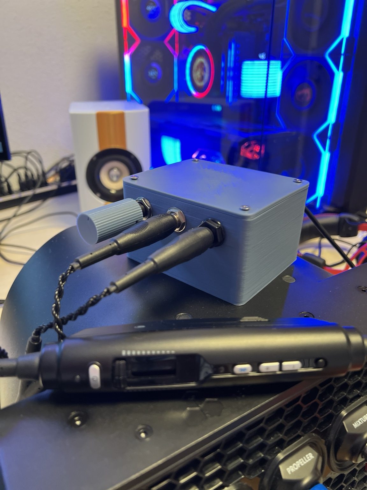
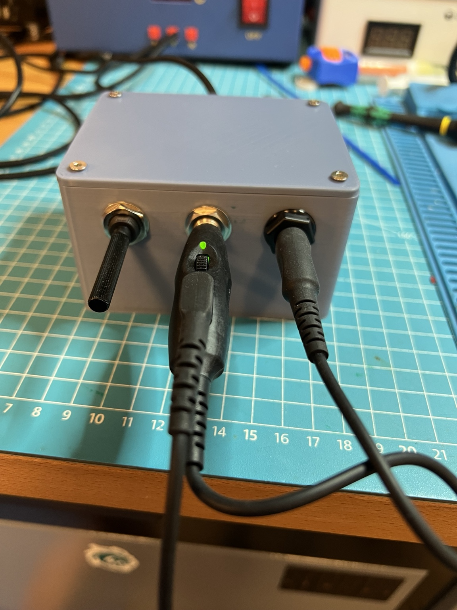
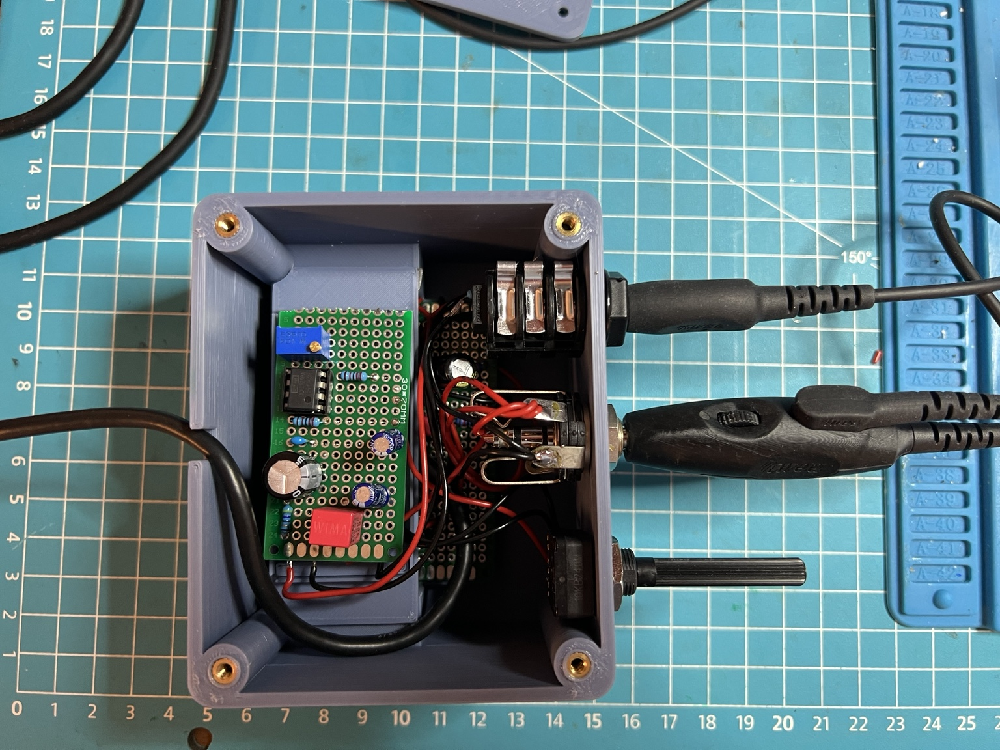

# GA Headset USB Adapter V2 — Analog Sidetone

V2 ist eine Erweiterung des funktionierenden V1-Adapters um einen regelbaren **analogen Sidetone**.

Das V1-Mikrofonsignal wird zusätzlich abgegriffen und durch eine OPA2134-basierte Analogstufe geführt. Das verstärkte Signal wird über einen 10-kΩ-Log-Poti in der Lautstärke geregelt und anschließend in beide Kopfhörerkanäle eingespeist.

Die V1-Funktion bleibt erhalten:

- USB-Mikrofoneingang
- 12-V-Mikrofon-Bias
- Stereo-PC-Audio
- Dual-GA-Anschlüsse

V2 ergänzt:

- analogen Sidetone ohne wahrnehmbare Software-Latenz
- regelbare Sidetone-Lautstärke
- Mikrofon-Vorverstärkung mit OPA2134PA
- getrennte passive Einspeisung des Sidetone-Signals in links und rechts
- 100-Ω-Entkopplung der aktiven USB-Soundkarten-Ausgänge

## Getesteter V2-Prototyp

Der fertige Prototyp wurde mit einem **Lightspeed Zulu 4 Dual-GA** im PC-/Simulatorbetrieb getestet.

Die getestete finale Audio-Mischung:

```text
USB LEFT  -> 100 Ω -> J2 Tip
USB RIGHT -> 100 Ω -> J2 Ring

SIDETONE OUT -> 220 Ω -> J2 Tip
SIDETONE OUT -> 220 Ω -> J2 Ring
```

Der 100-kΩ-Gain-Trimmer der aufgebauten Zusatzplatine wurde im funktionierenden Prototyp auf ungefähr **14,3 kΩ effektiven Widerstand** eingestellt.

Dieser Wert ist ein dokumentierter Prototypwert und keine zwingende Vorgabe für jeden Aufbau.

## Bilder








## Gehäuse / CAD

Zum V2 gehören ein neu konstruiertes höheres Gehäuse, eine herausnehmbare isolierende Zwischenablage für die gestapelten V1-/V2-Platinen und ein eigener Sidetone-Drehknopf.

Die Teile wurden beim dokumentierten V2-Prototyp gedruckt und erfolgreich verwendet.

- [CAD-Dokumentation](cad/README.md)
- [OpenSCAD-Gehäuse](cad/GA_Headset_V2.scad)
- [OpenSCAD-Knauf](cad/GA_Headset_V2_Knauf.scad)
- [STL-Dateien](cad/stl/)

## Dokumentation

- [Stückliste](hardware/BOM.md)
- [Funktionsschema](hardware/schematic.md)
- [Verdrahtung](docs/wiring.md)
- [Aufbau und Inbetriebnahme](docs/build.md)
- [Troubleshooting](docs/troubleshooting.md)

## Sicherheit

**Nur für PC und Flugsimulator. Nicht für den Einsatz im Flugzeug und nicht zum Anschluss an Flugzeug-Audio-, Funk-, Intercom- oder Bordstromsysteme.**

V2 ist ein DIY-Prototyp und keine zertifizierte Aviation-Hardware.
